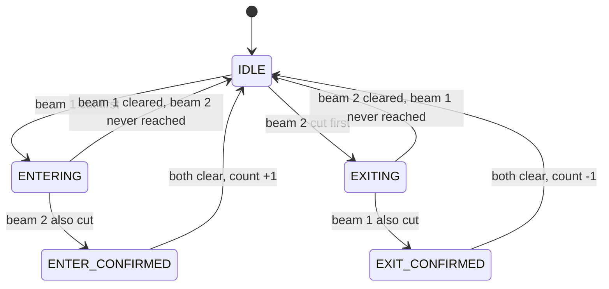

# Smart Room Visitor Counter

An ESP32-based bidirectional people counter that knows the difference between
someone walking **in** and someone walking **out** — and uses that live
occupancy figure to run the room: staged lighting, a cooling fan, a servo door
lock at capacity, a 16x2 LCD, and a Wi-Fi dashboard you can open from your
phone.

Two laser/LDR beams across the doorway are read as an ordered pair. The order
they break in gives the direction of travel, so the count stays correct instead
of just incrementing on every interruption.

---

## Features

- **Bidirectional counting** — a 5-state machine resolves direction from the
  order the two beams break, and only commits a count once both beams are clear
  again. Loitering in the doorway does not inflate the count.
- **Timeout failsafe** — if a crossing sequence stalls for more than 3 s
  (someone stops halfway, an arm blocks a beam), the state machine resets
  instead of freezing.
- **Staged, gamma-corrected lighting** — four LED pairs fade up in sequence
  when the room becomes occupied and fade back down when it empties. An 8-bit
  gamma table makes the ramp look linear to the eye rather than bunched at the
  bottom.
- **Automatic fan** — switches on at 5 occupants, off below 5.
- **Servo door lock at capacity** — at 10 occupants the servo sweeps closed one
  degree at a time (a slow sweep avoids an end-stop stall) and re-opens as soon
  as the count drops.
- **LCD with event popups** — normally shows occupancy and lock state; briefly
  takes over for 1.5 s to announce events, each with its own buzzer tone.
- **Wi-Fi dashboard** — the ESP32 hosts its own access point and serves a live
  stats page. No router, no internet, no app.
- **Serial telemetry** — both raw LDR readings and the current count are
  printed every 200 ms, which is what you actually want while calibrating.

---

## Hardware

| Qty | Component |
|----:|-----------|
| 1 | ESP32 development board (30- or 38-pin DevKit) |
| 2 | Laser diode module (KY-008 or similar, 5 V) |
| 2 | LDR / photoresistor, each in a divider with a fixed resistor (10 kΩ is a good start) |
| 1 | 16x2 character LCD with I2C backpack (PCF8574, address `0x27`) |
| 1 | SG90 / MG90S hobby servo (door latch) |
| 1 | DC fan + low-side driver (transistor/MOSFET or relay module) |
| 1 | Passive buzzer |
| 8 | LEDs + current-limiting resistors (wired as 4 pairs) |
| 1 | External 5 V supply able to cover the fan, servo and lasers |

The full wiring diagram is in **[`bidirectional_schematic.PDF`](bidirectional_schematic.PDF)**.

> **Power:** do not run the fan and servo off the ESP32's regulator. Give them
> the external 5 V rail and share only ground with the board. The firmware
> deliberately waits 3 s at boot for the rails to settle, and pauses 100 ms
> between talking to the LCD and switching the fan, because the fan's inrush
> spike otherwise corrupts the I2C bus mid-write.

### Pinout

| Function | GPIO |
|---|---|
| LDR 1 — entry/outside side | 34 *(ADC, input only)* |
| LDR 2 — inside | 35 *(ADC, input only)* |
| Laser 1 | 32 |
| Laser 2 | 33 |
| Fan driver | 25 |
| Servo signal | 26 |
| Buzzer | 4 |
| LCD `SDA` / `SCL` | 21 / 22 |
| LED pair 1 | 27, 17 |
| LED pair 2 | 23, 16 |
| LED pair 3 | 19, 14 |
| LED pair 4 | 18, 13 |

GPIO 34 and 35 are input-only and have no internal pull-ups — that is fine
here, since each LDR sits in its own external divider.

---

## How the direction logic works

`LDR1` faces the outside of the doorway, `LDR2` the inside. A reading *below*
`LDR_THRESHOLD` means that beam is broken.



Counting only happens on the transition back to `IDLE`, when both beams are
clear. That single rule is what removes the double-counting and the
stand-in-the-doorway jitter that a naive "beam broken, so increment" design
suffers from. Any state other than `IDLE` also carries a 3 s deadline, after
which the machine resets itself rather than hanging.

---

## Behaviour by occupancy

| Occupants | What happens |
|---:|---|
| 0 | LED pairs fade down to off |
| 1 | LED pairs 1 to 4 fade up in sequence |
| 5 | Fan on |
| below 5 | Fan off |
| 10 | Door servo sweeps closed, `Room FULL` popup, long low tone |
| 9 or fewer | Door servo sweeps open, `Unlocked` popup |

The count is clamped to the range 0-10, so a missed crossing cannot push it
negative or past capacity.

---

## Getting started

### 1. Install the toolchain

Arduino IDE (1.8.19 or 2.x) with the **ESP32 board package version 3.x**
installed via Boards Manager.

> **This matters.** The sketch uses the core 3.x LEDC API — `ledcAttach(pin,
> freq, resolution)`. On ESP32 core 2.x that function does not exist and you
> will get a compile error; 2.x needs the older `ledcSetup()` plus
> `ledcAttachPin()` pair instead.

### 2. Install the libraries

From **Sketch > Include Library > Manage Libraries**:

- `LiquidCrystal I2C` (Frank de Brabander)
- `ESP32Servo` (Kevin Harrington / John K. Bennett)

`WiFi`, `WebServer` and `Wire` ship with the ESP32 core.

### 3. Flash it

Open [`bidirectional_code.ino`](bidirectional_code.ino), select your ESP32
board and port, and upload. Open the Serial Monitor at **115200 baud**.

> Arduino IDE expects a sketch to live in a folder with the same name as the
> `.ino` file. If the IDE offers to move `bidirectional_code.ino` into a folder
> for you, let it.

### 4. Open the dashboard

The ESP32 starts its own access point:

| | |
|---|---|
| SSID | `Smart Room` |
| Password | `12345678` |
| Dashboard | <http://192.168.4.1> |

The page shows current occupancy, total entries, total exits and lock status,
and refreshes itself every 3 seconds.

---

## Calibration

Alignment is the whole game. Get the serial output up first:

```
LDR1: 3120   |   LDR2: 2980   |   Current Count: 0
```

1. With both beams aimed properly at their LDRs, note the two resting values.
2. Break each beam by hand and note the values again.
3. Set `LDR_THRESHOLD` roughly midway between the two, closer to the broken
   reading if the room has bright ambient light:

```cpp
const int LDR_THRESHOLD = 2200;
```

Other constants worth knowing, all near the top of the sketch or in the
function that uses them:

| Constant | Default | Meaning |
|---|---|---|
| `LDR_THRESHOLD` | `2200` | Below this, the beam counts as broken |
| Sequence timeout | `3000` ms | How long a half-finished crossing is tolerated |
| Capacity | `10` | Count at which the door locks |
| Fan trigger | `5` | Count at which the fan runs |
| Popup duration | `1500` ms | How long an event holds the LCD |
| Fade step | every `2` ms | Lighting ramp speed |

---

## Troubleshooting

| Symptom | Likely cause |
|---|---|
| Count never moves | `LDR_THRESHOLD` set on the wrong side of the resting reading, or a beam is off target |
| Count moves in the wrong direction | `LDR1` and `LDR2` are swapped; `LDR1` must be the outside sensor |
| LCD blank or shows blocks | Wrong I2C address — scan the bus; some backpacks are `0x3F`, not `0x27` |
| LCD garbles when the fan switches | Fan is sharing the ESP32's supply; move it to the external rail |
| Servo twitches or stalls | Servo on the board's 5 V instead of the external rail, or the mechanical end-stop sits past 5 degrees |
| Sketch will not compile (`ledcAttach` undefined) | ESP32 core 2.x installed — upgrade to 3.x |
| LEDs flicker when the servo moves | A shared LEDC timer; the sketch reserves timer 3 for the servo, so check nothing added since has taken it |

---

## Security note

The access point ships with the default credentials `Smart Room` /
`12345678`, hard-coded in the sketch. That is fine for a bench demo, but
change both before leaving this running anywhere real — anyone in radio range
can otherwise join the AP and read the dashboard.

---

## License

This project is dual-licensed:

- **Firmware** (`*.ino` and any other source code) — [MIT License](LICENSE)
- **Hardware documentation** (the schematic and diagrams) —
  [CC BY 4.0](LICENSE-HARDWARE)

Use it, fork it, build it into your own room. Attribution appreciated.
